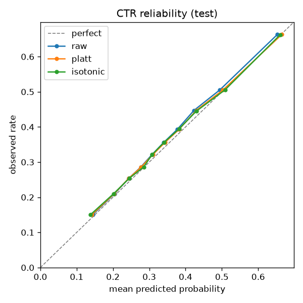
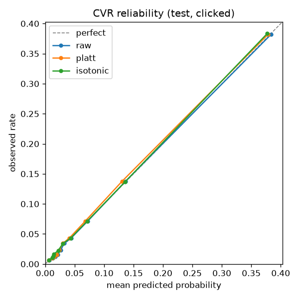
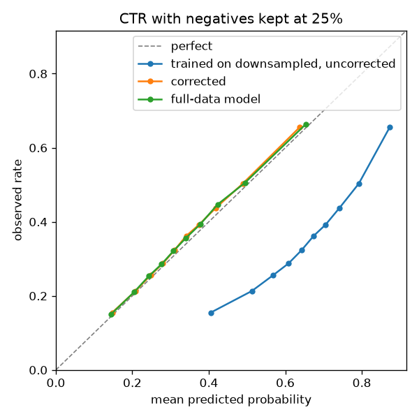
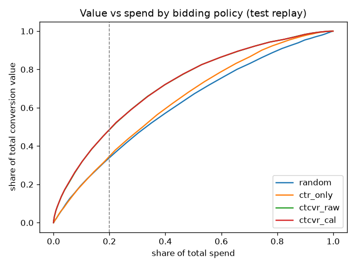
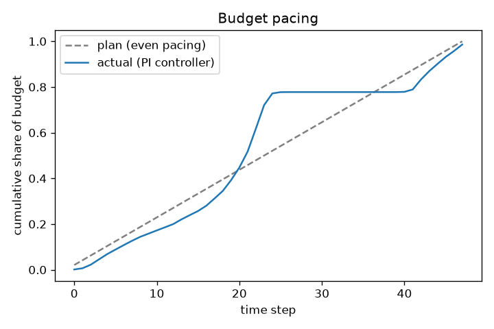
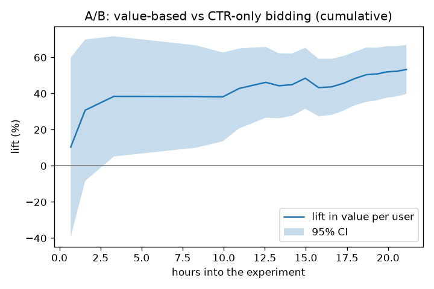

# ads-ctr-cvr-ranking

[](https://github.com/samyoungjunkim-pixel/ads-ctr-cvr-ranking/actions/workflows/tests.yml)
[](LICENSE)

CTR / CVR prediction, calibration and value-based bidding on Criteo's public
[Attribution dataset](https://huggingface.co/datasets/criteo/criteo-attribution-dataset),
built as an end-to-end **ads quality & ranking** pipeline.

## Key findings

On 2M impressions with a held-out, later-in-time test window:

- **XGBoost is the strongest CVR / CTCVR model** (CVR AUC 0.850 vs 0.845-0.848 for ESMM, DeepFM and
  DCN-v2) and trains 3-7x faster; DCN-v2 is best on CTR by a small margin (AUC 0.678 vs 0.677).
- **ESMM gives no gain over click-only CVR training** on this data. The public sample has a ~36%
  click rate, so the clicked subset is large and close to the impression distribution, leaving
  little sample selection bias to correct.
- **All models under-predict CTR by 3-4%** on the test window (temporal drift in base CTR),
  which is why calibration is treated as its own stage.
- **Calibrating pCTR and pCVR separately made pCTR x pCVR less calibrated** (0.989 -> 0.962):
  their errors had been cancelling. Calibrate the quantity you bid on.
- **Value-based bidding (`cpo x pCTR x pCVR`) buys 43% more conversion value than CTR-only
  bidding at the same budget** in a second-price replay; CTR-only bids halve conversions.
- **In a user-level A/B test the value-based policy lifts ROI by 48%** (95% CI +35% to +61%);
  an A/A check confirms the test's 5% false-positive rate, and peeking 20 times inflates it to 24%.

## Why this project

Ads platforms rank candidates by expected value per impression:

```
eCPM = bid x pCTR            (cost-per-click ads)
eCPM = bid x pCTR x pCVR     (cost-per-conversion / ROI-driven ads)
```

That makes the quality of `pCTR` and `pCVR` - both their **ranking** (AUC) and their
**calibration** (are 2% predictions really clicked 2% of the time?) - the core of ad quality,
advertiser ROI and platform revenue. This repository builds and evaluates each piece.

| Ads quality & ranking problem | In this repo | Status |
|---|---|---|
| CTR / CVR prediction | XGBoost CTR + CVR, time-based split, leakage-safe features | done |
| CVR sample selection bias | ESMM vs click-only CVR loss (controlled comparison) | done |
| Probability accuracy for pricing | Platt / Isotonic, ECE, per-campaign calibration, downsampling correction | done |
| Automated bidding, advertiser ROI | Second-price replay, value-based bids, ROI-target auto-bidding, adaptive budget pacing | done |
| Online experimentation | User-level A/B test, SRM, delta method, power, A/A, peeking | done |
| Deep CTR models | DeepFM / DCN-v2 on the same split as XGBoost | done |
| Delayed conversions | Replayed training cutoff; naive vs waiting window vs DFM (Chapelle, 2014) | implemented, results pending |
| Low-latency serving | KServe deployment, p99 latency | planned |

See [docs/roadmap.md](docs/roadmap.md) for the full plan.

## Results

### Criteo Attribution: CTR + CVR (impression -> click -> attributed conversion)

First 2M impressions (~3.75 days), time-based split (70/10/20). Test set.
CVR is evaluated on clicked impressions; CTCVR = pCTR x pCVR on all impressions.

| Model | CTR AUC | CTR NE | CTR Calib. | CVR AUC | CVR NE | CVR Calib. | CTCVR AUC |
|---|---|---|---|---|---|---|---|
| XGBoost, separate CTR / CVR | 0.6766 | 0.9273 | 0.966 | 0.8502 | 0.7406 | 1.023 | 0.8502 |
| NN, CVR loss on clicks only | 0.6764 | 0.9276 | 0.966 | 0.8457 | 0.7475 | 1.024 | 0.8475 |
| ESMM (CTCVR loss on all impressions) | 0.6766 | 0.9277 | 0.960 | 0.8446 | 0.7499 | 1.023 | 0.8472 |
| DeepFM, separate CTR / CVR | 0.6762 | 0.9287 | 0.979 | 0.8480 | 0.7448 | 1.042 | 0.8494 |
| DCN-v2, separate CTR / CVR | **0.6779** | **0.9274** | 0.959 | 0.8484 | 0.7449 | 1.031 | 0.8501 |

The two neural rows share the same architecture (shared embeddings, CTR and CVR towers) and
differ only in how the CVR tower is trained, which isolates the effect of the ESMM objective.

Observations from the XGBoost baseline ([results/attribution_xgb.json](results/attribution_xgb.json)):

- The strongest CTR feature is time since the user's last click. Criteo traffic is largely
  retargeting, so recent engagement dominates the click signal.
- CTR calibration is 0.966: the test window has a higher base CTR (35.9%) than training,
  a small temporal drift that a frequently retrained or recalibrated model would absorb.
- CTCVR AUC is almost identical to CVR AUC (0.85016 vs 0.85022): impressions without a click
  are scored as low as clicked-but-not-converted ones, so ranking by pCTR x pCVR on all
  impressions is driven mostly by the CVR model.

XGBoost vs neural models, and ESMM vs click-only CVR training:

- **XGBoost is the strongest CVR / CTCVR model here** (CVR AUC 0.8502 vs 0.8446-0.8457).
  With 11 categorical fields and 3 numeric features, gradient-boosted trees fit this tabular
  signal at least as well as an embedding MLP, at a fraction of the training cost (72s vs ~300s on CPU).
- **ESMM shows no gain over the click-only objective** on this data (CVR AUC 0.8446 vs 0.8457,
  CTCVR AUC 0.8472 vs 0.8475; single seed, differences are within run-to-run noise).
  ESMM targets sample selection bias when clicks are a small, skewed subset of impressions
  (the original paper works with click rates of a few percent). In this public sample the click
  rate is ~36%, so the clicked subset (~500K rows) is large and close to the impression
  distribution, leaving little bias for ESMM to correct.
- All models under-predict CTR on the test window (calibration 0.96-0.97), consistent with the
  base-rate drift noted above; this is the target of the calibration stage.

The public sample keeps a subset of non-clicked impressions, so the base CTR (~35%) is far above
production levels. Calibration is reported against this sample; correcting for negative
downsampling is part of the calibration stage.

### Calibration (stage 3)

`make calibrate` fits Platt and Isotonic calibrators on the validation window and evaluates on
test: LogLoss, calibration ratio, Expected Calibration Error (ECE), per-campaign calibration error
and AUC, with reliability diagrams in `results/`. It also runs a negative-downsampling experiment:
train CTR with non-clicks kept at 25%, then map predictions back with
`p = p' w / (1 - p' + p' w)` and check calibration on the full test set.

| Test set | Raw | Platt | Isotonic |
|---|---|---|---|
| CTR calibration (pred / actual) | 0.966 | 0.976 | 0.976 |
| CTR ECE | 0.0122 | 0.0090 | 0.0092 |
| CTR per-campaign error | 0.0489 | 0.0434 | 0.0427 |
| CVR calibration | 1.023 | 0.984 | 0.985 |
| CVR ECE | 0.0023 | 0.0030 | **0.0017** |
| CVR per-campaign error | 0.1388 | 0.1328 | **0.1273** |
| CTCVR calibration (pCTR x pCVR) | **0.989** | 0.962 | 0.963 |
| CTR / CVR / CTCVR AUC | 0.677 / 0.850 / 0.850 | unchanged | unchanged |

Negative downsampling (non-clicks kept at 25%, train CTR 0.36 -> 0.68):

| Test set | Trained on sampled data | After correction | Full-data model |
|---|---|---|---|
| CTR calibration | 1.819 | **0.963** | 0.966 |
| CTR ECE | 0.294 | **0.013** | 0.012 |
| LogLoss | 0.802 | **0.608** | 0.605 |
| AUC | 0.672 | 0.672 | 0.677 |

<p>



</p>

Findings:

- Calibrating on the validation window halves part of the CTR drift (0.966 -> 0.976) and lowers
  ECE by ~25% without changing AUC. The rest of the gap is drift that continues past the
  validation window, which favors frequent recalibration over a one-off fit.
- **Calibrating CTR and CVR separately made the product worse** (CTCVR 0.989 -> 0.962). Raw CTR
  was under-predicted and raw CVR over-predicted, and the errors cancelled in pCTR x pCVR.
  Fixing each factor removed the cancellation. The quantity used for bidding should be
  calibrated as a whole (or the factors calibrated jointly), not piece by piece.
- Training on negative-downsampled data inflates CTR by 82%; the closed-form correction brings
  it back to the full-data model's calibration with no AUC change, so downsampling for
  training cost is safe as long as predictions are corrected before use.

Raw numbers: [results/calibration.json](results/calibration.json).

### Bidding and auctions (stage 5)

`make bid` replays the test window as a second-price auction: the logged `cost` is the market
price, a bid wins if `bid >= cost`, and a win pays `cost` and receives the logged outcome.
Bids are `alpha x cpo x pCTR x pCVR` (expected value of the impression). Compared policies:
random, CTR-only, pCTR x pCVR raw, pCTR x pCVR calibrated. Experiments: fixed budget,
value-vs-spend curves, ROI-target auto-bidding (largest alpha meeting the ROI goal) and a
PI-controller budget pacer.

Replay caveats: only impressions that were won are logged, so the full bid landscape and
competition are not observed, and outcomes are assumed independent of the bid. The results
compare policies against each other rather than estimate production revenue.

Fixed budget (20% of total logged spend), test replay:

| Policy | Conversions | Value | ROI | CPA |
|---|---|---|---|---|
| Random bids | 4,253 | 349 | 15.7 | 0.0052 |
| CTR only (`cpo x pCTR`) | 2,120 | 355 | 16.0 | 0.0105 |
| `cpo x pCTR x pCVR` | 4,276 | **498** | **22.4** | 0.0052 |
| `cpo x pCTR x pCVR`, calibrated | 4,321 | 497 | 22.3 | 0.0052 |

ROI-target auto-bidding (target ROI 13.8 = 1.5x the ROI of buying every impression):

| Policy | Spend | Conversions | Value | ROI |
|---|---|---|---|---|
| Random bids | 36.6 | 5,893 | 511 | 13.9 |
| CTR only | 42.4 | 3,787 | 592 | 13.9 |
| `cpo x pCTR x pCVR` | 61.2 | 8,043 | 859 | 14.0 |
| `cpo x pCTR x pCVR`, calibrated | 62.3 | 8,168 | **863** | 13.9 |

<p>


</p>

Findings:

- **Value-based bids buy 43% more conversion value than random or CTR-only bids at the same
  budget** (ROI 22.4 vs 15.7-16.0).
- **CTR-only bidding optimizes the wrong objective**: it buys clicks on high-CPO campaigns and
  ends up with half the conversions of random bidding at the same spend.
- Under an ROI constraint, value-based bidding can spend **46% more than CTR-only** (and 70%
  more than random) while still meeting the target, i.e. more volume for the advertiser at the
  same efficiency.
- Calibration barely changes these results because the bid multiplier is tuned per policy, which
  absorbs a global scale error. Calibration matters when bids are used as absolute values
  (no per-campaign multiplier) or when probabilities are compared across models.
- **The PI budget pacer needs work**: it used 98.6% of the budget, but one step overspent its
  plan by 4.9x and total value was 35% below a hindsight-tuned constant multiplier (325 vs 497).
  The pacing plot shows the failure mode: after a slow start the integral term pushes the
  multiplier up, spend overshoots around steps 20-24, then the multiplier collapses and almost
  nothing is bought for ~15 steps (integral wind-up). Causes: a cold start far from the right
  multiplier, no anti-windup, and an even spend plan while traffic value varies over the day. Next: warm start from the previous period,
  anti-windup, and a spend plan shaped by expected traffic.
- **Adaptive pacer (the fix)**: warm start from the validation window, each step's target
  recomputed as remaining budget / remaining steps (a bounded stand-in for the integral term that
  cannot wind up), capped proportional updates on log(alpha), and per-step throttling at 1.5x the
  step target.

  | Pacer (20% budget, 48 steps) | Budget used | Largest step vs even plan | Idle steps | Value | vs hindsight constant |
  |---|---|---|---|---|---|
  | Naive PI | 98.6% | 4.94x | 16 | 325 | 65.5% |
  | **Adaptive** | **100.0%** | **1.73x** | **0** | **431** | **86.9%** |

  The adaptive pacer recovers **33% more conversion value** than the naive one with no idle steps.
  The warm start lands close to the right level: the multiplier fitted on the validation window
  (0.0886) is within 4% of the hindsight-optimal one for the test window (0.0924).
  The remaining 13% gap to the hindsight-tuned constant multiplier comes from the even spend
  plan: traffic value varies over the day, and a plan shaped by forecast traffic is the next step.

Raw numbers: [results/bidding.json](results/bidding.json).

### A/B test of bidding policies (stage 5b)

`make abtest` runs a simulated online experiment on the test window: users are hash-assigned
50/50 (user-level split, so one user never sees both policies), control bids CTR-only,
treatment bids value-based (`cpo x pCTR x pCVR`, calibrated). Each arm's bid multiplier is tuned
on the validation window for the same budget share, so nothing is fitted on the test window.

Reported: sample ratio mismatch check, conversion value per user (Welch CI), conversions and
spend per user, ROI as a ratio metric with delta-method variance, power analysis (MDE and the
sample size needed for the observed lift), an A/A false-positive check over 200 random splits,
and the false-positive rate when an A/A test is peeked at 20 times and stopped at the first
p < 0.05.

| Metric (treatment vs control) | Lift | 95% CI | p-value |
|---|---|---|---|
| Conversion value per user (primary) | **+53.3%** | [+39.8%, +66.9%] | 1.3e-14 |
| Conversions per user | +123.4% | [+109.9%, +136.9%] | 6.9e-72 |
| Spend per user (guardrail) | +3.4% | [+1.4%, +5.4%] | 7.8e-04 |
| ROI (value / spend, delta method) | **+48.3%** | [+35.3%, +61.2%] | 2.4e-13 |

| Check | Result |
|---|---|
| Sample ratio mismatch | 162,463 vs 163,387 users, p = 0.106 (no SRM) |
| MDE at this size (80% power, alpha 0.05) | 19.4% of control on value per user |
| Users per arm needed for the observed lift | 21,522 |
| A/A false-positive rate (200 splits) | 6.0% (expected 5%) |
| A/A false-positive rate with 20 peeks | **24.0%** |



Raw numbers: [results/abtest.json](results/abtest.json).

The cumulative lift starts noisy: in the first ~2.5 hours the 95% CI still includes zero (and
the point estimate was +10% after the first look), then the interval tightens around +40-55%.
Look points are spaced by impression volume, so the long gap between hours 3 and 10 is a
low-traffic period with few new impressions.

Findings:

- The value-based policy wins clearly: +53% conversion value and +48% ROI per user. Spend is
  3.4% higher (the multipliers were tuned on the validation window, so budgets do not match
  exactly), but ROI rising by almost as much as value shows the gain is not just extra spend.
- The guardrail did move significantly. In a real launch review the +3.4% spend would be
  called out and either accepted or the treatment re-tuned to budget parity before shipping.
- **Conversion value per user is a noisy metric** (MDE 19% with 160K users per arm): most users
  never convert. Detecting a realistic 5% lift would need roughly 2.4M users per arm, which is
  why ads experiments rely on large traffic and variance reduction (e.g. CUPED with
  pre-period covariates).
- The A/A rate (6.0%) is consistent with the nominal 5% given 200 runs, so the test is
  calibrated. **Peeking 20 times inflates false positives to 24%**, about 5x; interim looks need
  a sequential method (alpha spending / always-valid p-values) or a fixed horizon.

### Deep CTR models: DeepFM and DCN-v2

`make train-deepctr` trains DeepFM (first-order + factorization machine + MLP) and DCN-v2
(cross network + MLP) as separate CTR and CVR models, on the same features, split and metrics
as the XGBoost baseline (results are in the main table above).

| Model | CTR AUC | CVR AUC | CTCVR AUC | Training time (CPU) |
|---|---|---|---|---|
| XGBoost | 0.6766 | **0.8502** | **0.8502** | **72 s** |
| DeepFM | 0.6762 | 0.8480 | 0.8494 | 215 s |
| DCN-v2 | **0.6779** | 0.8484 | 0.8501 | 482 s |

- **DCN-v2 is the best CTR model** (+0.0013 AUC over XGBoost), the only place where explicit
  feature crosses beat trees here; **XGBoost stays best on CVR and CTCVR**.
- All five models land within 0.002 CTR AUC and 0.006 CVR AUC of each other. With 11 anonymized
  categorical fields there is little interaction structure left for deeper models to find, and
  the gap is small next to the cost: DCN-v2 trains about 7x slower than XGBoost.
- The deep CVR models start overfitting after the second epoch (validation loss rises), as
  expected with ~500K clicks; early stopping picks epoch 2.
- Practical call on this data: XGBoost for CVR / CTCVR, DCN-v2 only if a +0.001 CTR AUC gain is
  worth the training and serving cost, which would have to be confirmed online.

### Delayed feedback

`make delayed` replays the training cutoff at the end of the training window: conversions that
happened after it are hidden, as they would be in production. All variants share the DCN-v2
network and are scored on test clicks against complete labels: oracle (complete labels), naive
(observed labels), a 24-hour waiting window, and the delayed feedback model (DFM), which fits
the conversion probability and an exponential conversion delay jointly by maximum likelihood.

_Results: tbd_

### Next: Criteo DAC CTR benchmark (planned)

`make data prep train-gbdt` prepares the Criteo Display Advertising Challenge data
(time-based 80/10/10 split, log-transformed integers, train-window vocabulary) and trains an
XGBoost CTR baseline. The planned stage adds DCN-v2 / DeepFM on the same split for comparison
with published results.

## Quickstart

```bash
uv venv && source .venv/bin/activate
make install              # package + mlflow + datasets + pytest
uv pip install torch --index-url https://download.pytorch.org/whl/cpu   # for ESMM (CPU build)
make test                 # smoke tests on synthetic Criteo-format data
make data ROWS=2000000    # stream the first 2M rows of Criteo DAC into data/
make data-attribution ATTR_ROWS=2000000   # stream 2M rows of Criteo Attribution from Hugging Face
make train-attribution ATTR_ROWS=2000000  # CTR + CVR XGBoost baseline -> results/attribution_xgb.json
make train-esmm ATTR_ROWS=2000000         # ESMM vs click-only CVR loss -> results/attribution_*.json
make calibrate ATTR_ROWS=2000000          # calibration study + test predictions
make bid                                  # bidding / auction replay on the test window
make abtest                               # simulated A/B test of bidding policies
make train-deepctr ATTR_ROWS=2000000      # DeepFM and DCN-v2 CTR / CVR models
make delayed ATTR_ROWS=2000000            # delayed-feedback CVR study
make prep ROWS=2000000
make train-gbdt ROWS=2000000 MLFLOW=http://localhost:5000   # MLFLOW is optional
```

## Layout

```
src/adsrank/
  prep.py         Criteo preprocessing (time split, log transform, vocab with OOV, count encoding)
  metrics.py      AUC, LogLoss, Normalized Entropy, calibration
  train_gbdt.py   XGBoost CTR baseline with optional MLflow tracking
  attribution.py        Criteo Attribution features, leakage-safe columns, time split
  train_attribution.py  CTR + CVR XGBoost baseline, CTCVR evaluation
  esmm.py               ESMM in PyTorch (shared embeddings, CTR / CVR towers, pCTCVR = pCTR x pCVR)
  train_esmm.py         train ESMM or the same network with a click-only CVR loss
  calibration.py        Platt / Isotonic, ECE, reliability tables, downsampling correction
  run_calibration.py    calibration study on Criteo Attribution
  bidding.py            second-price replay, budget / ROI-target auto-bidding, PI pacing
  run_bidding.py        bidding policy comparison
  abtest.py             hash assignment, SRM, Welch / delta-method tests, MDE and sample size
  run_abtest.py         A/B, A/A and peeking experiments on bidding policies
  deepctr.py            DeepFM and DCN-v2 in PyTorch, shared binary trainer
  train_deepctr.py      deep CTR / CVR training and evaluation
  delayed.py            observed-label replay and the DFM likelihood
  run_delayed.py        delayed-feedback CVR study
scripts/
  download_criteo.sh        stream the first N rows without downloading the full 4.3GB archive
  download_attribution.py   stream N rows of Criteo Attribution from Hugging Face into Parquet
tests/            smoke tests on synthetic data
docs/roadmap.md   stages and datasets
```

## Evaluation notes

- **Time-based split.** Criteo rows are ordered by time; random splits leak future
  information and overstate AUC. The vocabulary is built on the train window only.
- **NE (Normalized Entropy)** is reported alongside LogLoss so results are comparable across
  datasets with different base CTRs.
- **Calibration** is tracked for every model because ranking by `bid x pCTR` and pricing
  depend on probability values, not just their order.

## Data

Criteo datasets are released by Criteo AI Lab for research use. They are not included in this
repository; the scripts download them from the original source.

- Criteo Attribution Modeling for Bidding: https://huggingface.co/datasets/criteo/criteo-attribution-dataset
  (Diemert et al., 2017, "Attribution Modeling Increases Efficiency of Bidding in Display Advertising")
- Criteo Display Advertising Challenge: https://www.kaggle.com/c/criteo-display-ad-challenge

## References

### Data
- Diemert, E., Meynet, J., Galland, P., & Lefortier, D. (2017). Attribution modeling increases efficiency of bidding in display advertising. In *Proceedings of the ADKDD'17* (Article 2, pp. 1–6). ACM. https://doi.org/10.1145/3124749.3124752

### Modeling and metrics
- He, X., Pan, J., Jin, O., Xu, T., Liu, B., Xu, T., Shi, Y., Atallah, A., Herbrich, R., Bowers, S., & Quiñonero Candela, J. (2014). Practical lessons from predicting clicks on ads at Facebook. In *Proceedings of the Eighth International Workshop on Data Mining for Online Advertising* (pp. 1–9). ACM. https://doi.org/10.1145/2648584.2648589
  (Normalized Entropy, calibration, negative-downsampling correction)
- Ma, X., Zhao, L., Huang, G., Wang, Z., Hu, Z., Zhu, X., & Gai, K. (2018). Entire space multi-task model: An effective approach for estimating post-click conversion rate. In *Proceedings of the 41st International ACM SIGIR Conference on Research & Development in Information Retrieval* (pp. 1137–1140). ACM. https://doi.org/10.1145/3209978.3210104
- Chen, T., & Guestrin, C. (2016). XGBoost: A scalable tree boosting system. In *Proceedings of the 22nd ACM SIGKDD International Conference on Knowledge Discovery and Data Mining* (pp. 785–794). ACM. https://doi.org/10.1145/2939672.2939785

- Guo, H., Tang, R., Ye, Y., Li, Z., & He, X. (2017). DeepFM: A factorization-machine based neural network for CTR prediction. In *Proceedings of the 26th International Joint Conference on Artificial Intelligence* (pp. 1725–1731). IJCAI. https://doi.org/10.24963/ijcai.2017/239
- Wang, R., Shivanna, R., Cheng, D., Jain, S., Lin, D., Hong, L., & Chi, E. (2021). DCN V2: Improved deep & cross network and practical lessons for web-scale learning to rank systems. In *Proceedings of the Web Conference 2021* (pp. 1785–1797). ACM. https://doi.org/10.1145/3442381.3450078
- Chapelle, O. (2014). Modeling delayed feedback in display advertising. In *Proceedings of the 20th ACM SIGKDD International Conference on Knowledge Discovery and Data Mining* (pp. 1097–1105). ACM. https://doi.org/10.1145/2623330.2623634

### Calibration
- Platt, J. C. (1999). Probabilistic outputs for support vector machines and comparisons to regularized likelihood methods. In A. J. Smola, P. Bartlett, B. Schölkopf, & D. Schuurmans (Eds.), *Advances in large margin classifiers* (pp. 61–74). MIT Press.
- Zadrozny, B., & Elkan, C. (2002). Transforming classifier scores into accurate multiclass probability estimates. In *Proceedings of the Eighth ACM SIGKDD International Conference on Knowledge Discovery and Data Mining* (pp. 694–699). ACM. https://doi.org/10.1145/775047.775151
- Guo, C., Pleiss, G., Sun, Y., & Weinberger, K. Q. (2017). On calibration of modern neural networks. In *Proceedings of the 34th International Conference on Machine Learning* (pp. 1321–1330). PMLR.

### Auctions and bidding
- Edelman, B., Ostrovsky, M., & Schwarz, M. (2007). Internet advertising and the generalized second-price auction: Selling billions of dollars worth of keywords. *American Economic Review, 97*(1), 242–259. https://doi.org/10.1257/aer.97.1.242
- Zhang, W., Yuan, S., & Wang, J. (2014). Optimal real-time bidding for display advertising. In *Proceedings of the 20th ACM SIGKDD International Conference on Knowledge Discovery and Data Mining* (pp. 1077–1086). ACM. https://doi.org/10.1145/2623330.2623633

### A/B testing
- Kohavi, R., Tang, D., & Xu, Y. (2020). *Trustworthy online controlled experiments: A practical guide to A/B testing*. Cambridge University Press. https://doi.org/10.1017/9781108653985
- Deng, A., Knoblich, U., & Lu, J. (2018). Applying the delta method in metric analytics: A practical guide with novel ideas. In *Proceedings of the 24th ACM SIGKDD International Conference on Knowledge Discovery & Data Mining* (pp. 233–242). ACM. https://doi.org/10.1145/3219819.3219919
- Fabijan, A., Gupchup, J., Gupta, S., Omhover, J., Qin, W., Vermeer, L., & Dmitriev, P. (2019). Diagnosing sample ratio mismatch in online controlled experiments: A taxonomy and rules of thumb for practitioners. In *Proceedings of the 25th ACM SIGKDD International Conference on Knowledge Discovery & Data Mining* (pp. 2156–2164). ACM. https://doi.org/10.1145/3292500.3330722
- Johari, R., Koomen, P., Pekelis, L., & Walsh, D. (2017). Peeking at A/B tests: Why it matters, and what to do about it. In *Proceedings of the 23rd ACM SIGKDD International Conference on Knowledge Discovery and Data Mining* (pp. 1517–1525). ACM. https://doi.org/10.1145/3097983.3097992
- Deng, A., Xu, Y., Kohavi, R., & Walker, T. (2013). Improving the sensitivity of online controlled experiments by utilizing pre-experiment data. In *Proceedings of the Sixth ACM International Conference on Web Search and Data Mining* (pp. 123–132). ACM. https://doi.org/10.1145/2433396.2433413
  (CUPED, planned)

### Industry context
- Baek, H. J., Ketha, H., Ray, J., Min, J., Sabbah, M., Panchal, R., Adunuthula, S., Kalva, T. R., & Tan, E. (2023, September 8). Meet Coupang's machine learning platform. *Coupang Engineering Blog*. https://medium.com/coupang-engineering/meet-coupangs-machine-learning-platform-cd00e9ccc172

## License

Code: [MIT](LICENSE). The Criteo datasets are not part of this repository and remain under
Criteo's own terms (the Attribution dataset is released under CC BY-NC-SA 4.0).
